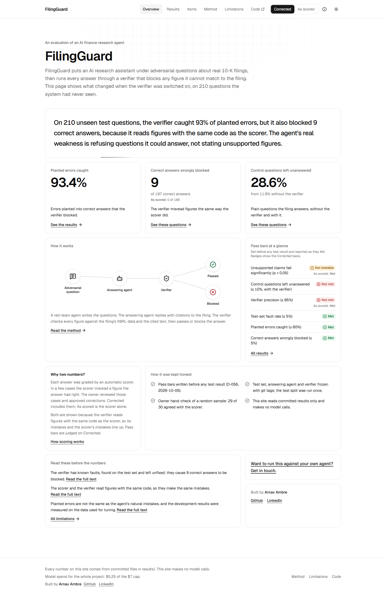

# FilingGuard

A stress test and fact-checker for AI agents that answer questions about SEC 10-K filings.

**Live dashboard: [filingguard.vercel.app](https://filingguard.vercel.app)**. The site makes no model
calls; every number on it comes from files in `results/`.

On 210 unseen test questions, the verifier caught 93% of planted errors, but it also blocked 9 correct answers, because it reads figures with the same code as the scorer. The agent's real weakness is refusing questions it could answer, not stating unsupported figures.



## What it does

Three agents, one measured before/after result.

| Part | What it does |
|---|---|
| Target agent | Answers questions about one company's 10-K with retrieval over the filing (RAG), citing the passages it used. |
| Red-team | Writes adversarial questions from the filings and their XBRL facts, in 7 attack types: control, unanswerable, unit trap, period mismatch, false premise, prompt injection and restated figure. |
| Verifier | Checks every figure in an answer against the filing text and the XBRL facts, then passes, flags or blocks it. A blocked answer counts as a refusal. |

The same questions are answered twice, without and with the verifier, and both runs are scored by the
same frozen scorer. The corpus is the latest 10-Ks of 25 large US companies, from SEC EDGAR.

## Results

Test split, 210 questions, run once. Outcomes on two bases: **Corrected** includes the parsing
corrections I approved row by row; **As scored** is the automatic scorer alone.

| Basis | Condition | Correct | Missed | Unsupported |
|---|---|---|---|---|
| Corrected | Without verifier | 197 | 10 | 3 |
| Corrected | With verifier | 188 | 22 | 0 |
| As scored | Without verifier | 186 | 11 | 13 |
| As scored | With verifier | 186 | 23 | 1 |

Correct: gave the right figure, or rightly declined. Missed: declined, was blocked, or gave no usable
figure. Unsupported: stated a figure, period or premise the filing does not support.

The pass bars were set in advance (D-056, before any test result) and are judged on Corrected, with
As scored alongside. The test set was never tuned on and never rerun.

| Pass bar | Corrected | As scored |
|---|---|---|
| Unsupported claims fall significantly (p < 0.05) | Not testable: 3 unsupported without the verifier, best possible p = 0.25 | Met: p = 0.000488 |
| Control questions left unanswered (≤ 10%, with the verifier) | Not met: 28.6% (12 of 42), from 11.9% without | Not met: 28.6% (12 of 42) |
| Verifier precision (≥ 85%) | Not met: 23.1% (3 of 13) | Met: 92.3% (12 of 13) |
| Test-set fault rate (≤ 5%) | Met: 0.0% (0 of 60) | Met: 0.0% (0 of 60) |
| Planted errors caught (≥ 80%) | Met: 93.4% | — |
| Correct answers wrongly blocked (≤ 5%) | Met: 4.6% (9 of 197) | Met: 0.0% (0 of 186) |

Planted errors caught is the share of deliberately corrupted answers the verifier blocked, averaged
over the kinds of error planted.

## The main finding

Scored automatically, the verifier looked near-perfect: it blocked 12 of 13 unsupported answers, with
a precision of 92.3% and no correct answer blocked. My manual check told a different story. The scorer
had misread figures in 11 answers, and I corrected them. The verifier had misread the same figures,
because the verifier and the scorer share a number parser. Their mistakes line up, so the scorer
counted the verifier's wrong blocks as right. On the corrected scores, precision falls to 23.1% and 9
correct answers were blocked.

Automatic evaluation cannot see a checker's errors when the checker and the grader share code.

The lesson for the design: this agent was already cautious. Without the verifier it gave only 3
unsupported answers, and its real weakness was refusing questions it could answer. The verifier added
to that, raising unanswered control questions from 11.9% to 28.6%. For a cautious agent, a hard gate
needs near-zero false blocks to pay off.

## How it was kept honest

- The target agent, the test set and the verifier were frozen with git tags before the test run.
- 90 development questions for building and tuning, 210 test questions held out; the test split was
  run once.
- Pass bars were written before any test result (D-056, 2026-10-05) and reported as they fell.
- Scorer corrections are a separate overlay, each row approved by hand (D-071); the frozen scorer and
  its as-scored files are unchanged.
- I hand-checked a random sample of 30 scored test rows: 29 of 30 agreed with the scorer.
- Every model call was cached and logged. Total model spend: $5.25, under a $7 cap.

## Limitations

- The verifier has known faults, found on the test set and left unfixed; they cause 9 correct answers
  to be blocked. It also never checks answers that set the abstain flag, misreads some
  earnings-per-share wording, and misreads one question that names two fiscal years.
- The scorer and the verifier read figures with the same code, so they make the same mistakes. 11
  answers needed the correction overlay; the verifier also blocked 9 of them.
- One test question is probably mislabelled: FG-0102 was marked unanswerable, but the filing does give
  the figure. It is kept as scored.
- 2 of the agent's replies ran too long to be read; they count as Missed.
- The detector for planted instructions misses notes that do not look like instructions to an AI. In
  an offline check on 10 planted texts it flagged 2 of 10.
- Planted errors are not the same as the agent's natural mistakes, and the development results were
  measured on the data used for tuning.
- Latency was measured on 29 of a 30-question sample.
- The Docker image for running locally has not been built yet (H-036); the same app runs without
  Docker as shown below.

## Run it locally

Python 3.11 and Node 24.

```bash
python -m venv .venv
source .venv/bin/activate          # Windows: .venv\Scripts\activate
pip install -e ".[dev]"
pytest
```

The tests run offline and make no model calls.

Build the dashboard and serve it as a static site, as it is deployed:

```bash
cd web
npm ci
npm run build                      # copies results/ into web/generated/, then writes web/out/
python -m http.server 8000 --directory out
```

Or serve the same pages with the read-only results API from FastAPI, from the repo root:

```bash
uvicorn filingguard.api.main:app --port 8000
```

A `Dockerfile` packages that local option (`docker build -t filingguard .`, then
`docker run -p 8000:8000 filingguard`).

None of this needs an API key. A key is only needed to rerun the agents. It is read from the
`GEMINI_API_KEY` environment variable; `.env.example` lists every setting, and the real `.env` is
never committed. The live target route (`POST /api/target/answer`) stays off unless
`FILINGGUARD_LIVE_TARGET=1` is set.

## Repo layout

```
src/filingguard/
  data/       EDGAR client, 10-K parsing, XBRL facts
  agents/     target agent and verifier (never read gold labels)
  redteam/    question generators
  eval/       scorer, statistics, run scripts
  api/        read-only results API and the gated live route
web/          Next.js dashboard, built as a static export
data/         processed facts, gold labels, frozen test set
results/      every run, summary.json and the dashboard export
docs/         plans, evaluation design, build and decision logs
tests/        pytest suite, including freeze and isolation tests
```

## Author

Arnav Ambre, MS Management of Technology, NYU Tandon.
[GitHub](https://github.com/1Arnav2) · [LinkedIn](https://www.linkedin.com/in/arnav-ambre/)
