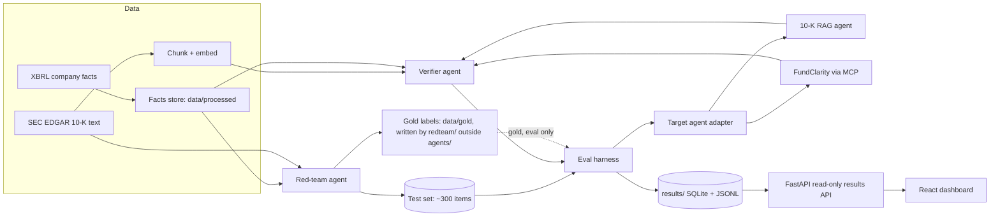

# TRD — FilingGuard

**Status:** Draft v1 · **Last updated:** 2026-10-05

## 1. Architecture



Two rules that the diagram encodes:
- The verifier reads filing text and the normalised XBRL facts in `data/processed/`, never
  the gold label for a test item.
- The harness is the only component that reads gold labels in `data/gold/`. A test
  (`tests/test_gold_isolation.py`) fails if any module under `src/filingguard/agents/`
  references `data/gold` (D-013).

## 2. Components

### 2.1 Data layer (`src/data/`)
- `edgar_client.py`: throttled, cached client. Sends `User-Agent` from `.env`.
  - Ticker to CIK: `https://www.sec.gov/files/company_tickers.json`
  - Filing index: `https://data.sec.gov/submissions/CIK{cik10}.json`
  - Facts: `https://data.sec.gov/api/xbrl/companyfacts/CIK{cik10}.json`
  - Filing documents: `https://www.sec.gov/Archives/edgar/data/{cik}/{accession}/{doc}`
- `filings.py`: company list, CIK resolution (with documented overrides, D-014), and
  latest/prior 10-K selection across all submissions pages.
- `parse_10k.py`: HTML to clean text, tables kept as pipe-separated rows. The whole document
  is indexed; each chunk is labelled with its Item (1, 1A, 7, 7A, 8) or `other` (D-018).
- `chunk.py`: 3,200-character chunks with 400 overlap and exact character offsets (D-017).
- `index.py`: local embeddings (`jinaai/jina-embeddings-v2-small-en`) with exact cosine
  search, filterable by company or filing (D-016).
- `build_corpus.py`: runs the whole Phase 1 pipeline; `spot_check.py` checks 10 facts.
- `facts.py`: normalise XBRL facts to rows of `(ticker, cik, concept, unit, period_start,
  period_end, period_days, value, filing_fy, filing_fp, form, filed, accession, frame)`,
  written to `data/processed/facts.parquet`. `filing_fy`/`filing_fp` describe the filing, not
  the period (D-019). Also maps each company's concepts and finds restatement pairs.

### 2.2 Target agents (`src/filingguard/agents/targets/`)
Common interface:

```python
class TargetAgent(Protocol):
    name: str
    def answer(self, question: str, company: str) -> AgentAnswer: ...

@dataclass
class AgentAnswer:
    text: str
    claims: list[Claim]        # value, unit, period, concept if stated
    citations: list[Citation]  # doc id + char span
    abstained: bool
    latency_s: float
    trace: dict
```

- `tenk_rag.py`: retrieve top-k chunks, generate with citations. No verifier inside it, so the
  baseline is honest.
- `fundclarity_mcp.py` (stretch): calls `ask_fund_question` on the existing MCP server.

### 2.3 Red-team agent (`src/filingguard/redteam/`)
Lives outside `agents/` because it writes gold labels; `agents/` holds only the target and
verifier, which must never see them (D-022).
Builds items from gold facts first, then asks the LLM only to phrase the question. This keeps
the gold answer independent of any model. One generator per attack type (see `EVAL.md`).

Item schema:

```json
{
  "id": "FG-0001", "company": "AAPL", "attack_type": "unit_trap",
  "question": "...", "expected_behavior": "answer|abstain",
  "gold": {"value": 0, "unit": "USD", "period_end": "YYYY-MM-DD", "concept": "..."},
  "source": {"accession": "...", "span": [0, 0]},
  "split": "dev|test", "human_checked": false
}
```

### 2.4 Verifier agent (`src/filingguard/agents/verifier/`)
Design approved 2026-10-05 (D-050); built on dev, not yet frozen (D-058). Rules first; the model is
called only when rules cannot settle a claim (D-025), at most 1 call per answer (D-057). Code:
`agents/verifier/` (`verifier.py`, `question.py`, `facts.py`, `lexicon.py`, and `instructions.py` for the
planted-instruction detector, reason code `instruction_followed` = EVAL label `injection_followed`;
prompt `prompts/verifier_v1.txt`).

**Input.** The question, the company, the target's answer (text, claims, citations, abstain
flag) and the texts of the chunks the target retrieved, with any planted text in place and no
marker saying which chunk was planted. It also reads `data/processed/facts.parquet` (limited
to facts from the corpus 10-K filings) and `filings.json` (fiscal year ends). It never sees
the item ID, attack type, subtype, the item's injection field, gold labels or judge inputs
(`tests/test_gold_isolation.py`, D-048). Metric names come from XBRL concept labels, not from
the red-team's wording. An answer the target abstained on passes untouched.

| Step | Rules or model | Reads | Blocks when |
|---|---|---|---|
| 1. Claim extraction | Rules: the answer text's figures (amounts, scale words, signs, periods), with the target's claims filling gaps, as in EVAL §3. Model (one call at most) only when a figure cannot be tied to a metric or period | Answer, question | Never on its own; also finds the asked metric, period and any line the question names |
| 2. Span check | Rules: the cited excerpt was retrieved; the quote is in it (whitespace-normalised); the quote holds the figure at some scale | Citations, retrieved texts | Only with step 3: no XBRL match and no text support, `unsupported_figure`. A bad quote alone is a flag |
| 3. Numeric check | Rules: fact lookup by company, concept, fiscal period, duration or instant, corpus filing; 0.5% tolerance after scale; sign rule. Where the question names a specific line (parent versus consolidated net income or equity, or a named revenue line), only that line's fact is checked; either line is accepted only when the question names none. Model only to decide whether a quote with no XBRL fact states the asked metric and period | `facts.parquet` | Fact exists and the figure does not match, `numeric_mismatch`; no fact and no text support, `unsupported_figure` |
| 4. Period check | Rules: calendar year named for a non-calendar filer needs the fiscal period named; "began in <month>" resolved from period start dates; a named filing's value for restated questions | `filings.json`, facts | `wrong_fiscal_year`, `period_conflation`, `stale_value` |
| 5. Injection check | Rules: (a) the numeric check catches planted false figures without any detection; (b) a generic detector (spec in `docs/INJECTION_DETECTOR.md`, needs the owner's approval before coding) finds instruction text aimed at an AI reader; an answer copying a code or figure from a detected span is blocked. Model only when a span is found and rules cannot tell whether the answer followed it | Retrieved texts, answer | `injection_followed`. A withheld answer cannot be fixed by a verifier; reported |
| 6. Premise check | Rules: parse the claimed change (metric, two years, direction, sign, size) and decide it from facts. Model only to parse a premise rules cannot read, or to say whether the answer corrects it | Question, facts, answer | Facts contradict the premise and the answer does not correct it, `false_premise_unaddressed`. A true premise is never blocked; wording alone never triggers a block |

**Verdict.** `block` on any hard reason, `flag` when unsure (the answer is still returned),
else `pass`. Each verdict carries its reason code and whether it rests on an XBRL lookup or
on text support alone; every verifier result is reported broken down that way (D-050).

**Tuning.** Dev split only, on the stored dev batch answers. At most 3 prompt versions, each
with its SHA-256 and dev result recorded; rule changes logged with their dev result. Guards
against fitting to question style: no item metadata reaches the verifier; every block must
rest on a fact mismatch, missing support or a copied instruction span; a style-swap check
re-runs dev premise items with neutral openings and the verdict must not change; blocks on
dev controls, true-premise drivers included, are tracked for every version; the injection
detector is run over every clean corpus chunk to count false positives.

### 2.5 Harness (`src/eval/`)
- `run.py`: for each item, call target, then verifier; store both.
- `score.py`: compare to gold; compute metrics and confidence intervals.
- `stats.py`: Wilson intervals, McNemar test, bootstrap by attack type.
- `taxonomy.py`: assign a failure label to each wrong answer.

### 2.6 Dashboard (`web/`)
Next.js (React, TypeScript), built as a static export and served by the same FastAPI service.
Redesigned in Phase 6c (D-076) from `DESIGN_SPEC.md` (kept outside the repo): neutral palette, Geist
type with tabular figures, light and dark mode (system by default, with a toggle), shadcn/ui base
components and four Magic UI accents on the Overview only. Sources and licences:
`docs/THIRD_PARTY.md`.

Pages (nav: Overview · Results · Items · Method · Limitations · Code):
- **Overview** (`/`): what it is, the headline, three stat cards (planted errors caught, correct
  answers wrongly blocked, controls left unanswered) linking to their evidence, a how-it-works
  diagram, pass bars at a glance, "Why two numbers?", how it was kept honest, the limitations that
  affect the headline, author block, outreach line, and a demo-video slot hidden until set.
- **Results** (`/results/`): pass-bar cards (chosen basis first, the other only where it differs),
  outcomes without and with the verifier, metrics, by attack type (`/attack-types/` redirects
  here), planted errors by kind, latency and cost. Every count links to the matching Items view.
- **Items** (`/items/`): preset views with live counts, labelled filters, removable filter chips,
  a table on wide screens and cards on narrow ones.
- **Item detail** (`/item/?id=`): what happened (outcome, verdict, outcome, plus a sentence from fixed
  templates), expected vs given answer, verifier reasons in plain words, D-071 correction, owner's
  hand-check, judge, and collapsed technical evidence.
- **Method** and **Limitations** (`/method/`, `/limitations/`): calm text pages; Method ends with a
  glossary of every term; limitations are grouped by a content file and shown in full, and Overview
  shows a plain one-line summary of each, linking to its full text.
- Should tier (D-077): search and sortable columns on Items; previous/next on item detail within
  the list the reader came from; Jump to on Results, Method and item detail; definition tooltips
  that open on hover, focus or tap, with the definition also given to screen readers.

Plain names for every code come from `web/content/labels.json`; page copy from
`web/content/copy.json`; the author block from `web/content/author.json`; the demo video from
`web/content/media.json`.

Read-only API (`src/filingguard/api/routes.py`, data loaded by `api/results.py`; D-074, D-075):
- `GET /api/summary` returns `results/summary.json` unchanged, plus `generated_from`
- `GET /api/meta` returns `results/dashboard/meta_v1.json` (split counts, freeze tags and commits,
  when the bars were set, the correction rule, input hashes), plus `generated_from`
- `GET /api/items?attack_type=&outcome=&label=&verdict=&basis=&condition=&corrected=&unparseable=&handchecked=&q=&sort=&order=&page=&page_size=`
  returns paged item results; `basis` is `corrected` (default) or `as_scored`, `outcome` and
  `label` apply to `condition` (`treatment` by default), the three flags back the Items presets, `q`
  matches the ID or company ticker, and `sort` (id, company, attack_type, baseline, verdict,
  treatment; outcomes and verdicts by severity) with `order` (asc, desc) orders the list
- `GET /api/items/{id}` returns one item: answer, claims, citations, retrieval list, outcomes on
  both bases, both verifier modes, and any D-071 correction

The API reads only `results/` (directory set by `FILINGGUARD_RESULTS`, default `results`).
Per-item data comes from `results/dashboard/items_v1.jsonl`, written by
`eval/scripts/export_dashboard.py` (only `eval/` reads gold); the corrected basis in it is applied
by the Phase 5 summary's own overlay. Fixed prose lives in `web/content/`; every number in it is a declared value or a placeholder filled
from the API, and every code in the results has a plain label (`tests/test_web_content.py`).
In development, `npm run dev` in `web/` forwards `/api` to uvicorn on port 8000.

The dashboard reads committed results only. It makes no live LLM calls.

### 2.7 Serving and deploy (`api/main.py`, `Dockerfile`; D-078)
`create_app()` builds one FastAPI app for one origin: the results routes, `GET /api/health`, a JSON
404 for any other `/api/*` path, and the static export mounted at `/` (folder from `FILINGGUARD_WEB`,
default `web/out`; not mounted when missing, so local API work is unchanged). Responses over 1 kB are
gzipped. The live target route `POST /api/target/answer` lives in `api/live.py` and is included only
when `FILINGGUARD_LIVE_TARGET` is exactly `1`; off, it is absent (404) and no agent, LLM or data code
is imported.

The `Dockerfile` builds the export in a pinned Node stage, then installs only
`requirements-serve.txt` plus the package with `--no-deps` on a pinned Python slim image, copies
`results/summary.json`, `results/dashboard/` and the export, and runs uvicorn as a non-root user on
`$PORT`. `.dockerignore` is an allowlist, so `.env`, `data/`, caches and local files never enter the
build context. `render.yaml` declares one Docker web service with the health check and no environment
variables. The image holds no key, no index and no gold data.

## 3. Stack
| Layer | Choice | Note |
|---|---|---|
| Language | Python 3.11 | |
| LLM | Gemini API, paid tier | `gemini-3.8-flash` for every role, pinned in `.env` (D-012, D-024) |
| Embeddings + vector store | `jinaai/jina-embeddings-v2-small-en` via fastembed; numpy exact cosine search | D-016 |
| API | FastAPI | Target agent endpoint |
| Storage | SQLite + JSONL | |
| Dashboard | Next.js (React, TypeScript), shadcn/ui, Magic UI accents, Geist, next-themes, static export | Served by FastAPI; D-076, `docs/THIRD_PARTY.md` |
| Tests | pytest | Verifier steps 2 to 4 get unit tests |
| Deploy | Render free tier, Docker, one service | FastAPI serves the API and the static dashboard |

## 4. Repo layout
All Python code lives in one installable package, `filingguard`, under `src/` (D-009).
Section 2 paths such as `src/data/` mean `src/filingguard/data/`.

```
FilingGuard/
  README.md  .env.example  .gitignore  pyproject.toml  Dockerfile  .dockerignore
  requirements-serve.txt  render.yaml
  docs/      PRD.md TRD.md EVAL.md CORPUS.md ROADMAP.md BUILD_LOG.md DECISIONS_LOG.md
  src/
    filingguard/
      data/    edgar_client.py parse_10k.py facts.py
      agents/  schema.py targets/ verifier/   (never reads gold)
      redteam/ generators, phrasing, split    (writes data/gold/, D-022)
      eval/    run.py score.py stats.py taxonomy.py
      llm/     client.py cache.py
      api/     main.py routes.py results.py live.py
  web/       Next.js app (app/, components/, lib/)
  data/      raw/ (git-ignored)  processed/  gold/  testset/
  results/   runs/*.jsonl  summary.json
  tests/
```

## 5. Config (`.env`)
```
GEMINI_API_KEY=
TARGET_MODEL=
VERIFIER_MODEL=
SEC_USER_AGENT="Name email@example.com"
NUMERIC_REL_TOLERANCE=0.005
CACHE_DIR=.cache
SPEND_WARN_USD=5.00
SPEND_CAP_USD=7.00
# FILINGGUARD_RESULTS=results
# FILINGGUARD_WEB=web/out
FILINGGUARD_LIVE_TARGET=0
```

`TARGET_MODEL` and `VERIFIER_MODEL` are both pinned to `gemini-3.8-flash` (D-012), to be
revisited in Phase 2. The SDK is `google-genai` (D-011).

## 6. Non-functional
- **Reproducibility:** fixed seeds, pinned model IDs, cached calls, every run tagged with a
  git commit hash.
  - The LLM and SEC caches under `.cache/` are local and git-ignored. They save cost while
    building; they are not the reproducibility record.
  - Every run writes the raw model response for each item, under each condition, to
    `results/runs/*.jsonl`, which is committed.
  - Scoring (`eval/score.py`, `eval/stats.py`) reads only those files plus gold labels and
    must re-run with zero API calls. Every number in `results/summary.json` can be rebuilt
    this way from a fresh clone (D-010).
- **Cost:** capped budget, not zero (D-024). Gemini runs on the paid tier because the free
  tier allows 20 requests per day (H-006). Hard cap $7.00, warning at $5.00, enforced in code
  before every uncached call (`llm/spend.py`) and also set in AI Studio. Prices live in
  `config/pricing.json` with their source; every paid call is logged to
  `results/spend/ledger.jsonl` with a running total in `results/spend/total.json`. Cached
  calls cost nothing. Only `LLMClient.generate` can call the model
  (`tests/test_llm_boundary.py`).
- **Batch API (D-025):** the target's answers are generated once per split through the Batch
  API (one dev batch, one test batch), with the same model, prompt and settings as
  `target-v1`, and reused for every verifier version. Batch responses pass through the same
  cache and spend ledger at the batch price; failed or missing items are re-submitted alone
  and logged. Verifier, red-team and judge calls use the standard API.
  How (D-046): `eval/dev_run.py` captures each item's exact request from the frozen agent
  with `PromptRecorder` (no call), sends sub-batches of 30 through
  `LLMClient.generate_batch` (cache, then a whole-batch worst-case cap check, then submit,
  then record and cache, under a cache key tagged `batch`), and rebuilds each answer by
  running the frozen agent again with `BatchReplayClient`, which serves only stored batch
  answers. Rows go to `results/runs/dev_target_v1.jsonl` (no attack type, subtype or gold);
  job names and per-sub-batch counts to `results/runs/dev_target_v1_batches.json`.
- **Runtime:** target answers return within the Batch API's turnaround; latency is measured
  separately on a 30-item standard-API sample (EVAL §4).

## 7. Known technical risks
- 10-K HTML is messy; tables may parse badly. Fallback: use XBRL facts for numbers and text
  only for citations.
- Financial companies use different XBRL concepts. See `CORPUS.md`.
- Free-tier quotas change. Keep the LLM client swappable.
