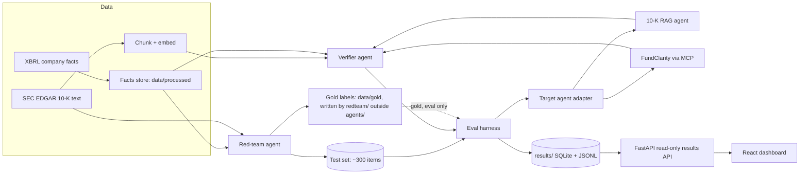

# TRD — FilingGuard

**Status:** Draft v1 · **Last updated:** 2026-10-04

## 1. Architecture



Two rules that the diagram encodes:
- The verifier reads filing text and the normalised XBRL facts in `data/processed/`, never
  the gold label for a test item.
- The harness is the only component that reads gold labels in `data/gold/`. A test
  (`tests/test_gold_isolation.py`) fails if any module under `src/filingguard/agents/`
  references `data/gold` (D-013).

## 2. Components

### 2.1 Data layer (`src/data/`)
- `edgar_client.py`: throttled, cached client. Sends `User-Agent` from `.env`.
  - Ticker to CIK: `https://www.sec.gov/files/company_tickers.json`
  - Filing index: `https://data.sec.gov/submissions/CIK{cik10}.json`
  - Facts: `https://data.sec.gov/api/xbrl/companyfacts/CIK{cik10}.json`
  - Filing documents: `https://www.sec.gov/Archives/edgar/data/{cik}/{accession}/{doc}`
- `filings.py`: company list, CIK resolution (with documented overrides, D-014), and
  latest/prior 10-K selection across all submissions pages.
- `parse_10k.py`: HTML to clean text, tables kept as pipe-separated rows. The whole document
  is indexed; each chunk is labelled with its Item (1, 1A, 7, 7A, 8) or `other` (D-018).
- `chunk.py`: 3,200-character chunks with 400 overlap and exact character offsets (D-017).
- `index.py`: local embeddings (`jinaai/jina-embeddings-v2-small-en`) with exact cosine
  search, filterable by company or filing (D-016).
- `build_corpus.py`: runs the whole Phase 1 pipeline; `spot_check.py` checks 10 facts.
- `facts.py`: normalise XBRL facts to rows of `(ticker, cik, concept, unit, period_start,
  period_end, period_days, value, filing_fy, filing_fp, form, filed, accession, frame)`,
  written to `data/processed/facts.parquet`. `filing_fy`/`filing_fp` describe the filing, not
  the period (D-019). Also maps each company's concepts and finds restatement pairs.

### 2.2 Target agents (`src/filingguard/agents/targets/`)
Common interface:

```python
class TargetAgent(Protocol):
    name: str
    def answer(self, question: str, company: str) -> AgentAnswer: ...

@dataclass
class AgentAnswer:
    text: str
    claims: list[Claim]        # value, unit, period, concept if stated
    citations: list[Citation]  # doc id + char span
    abstained: bool
    latency_s: float
    trace: dict
```

- `tenk_rag.py`: retrieve top-k chunks, generate with citations. No verifier inside it, so the
  baseline is honest.
- `fundclarity_mcp.py` (stretch): calls `ask_fund_question` on the existing MCP server.

### 2.3 Red-team agent (`src/filingguard/redteam/`)
Lives outside `agents/` because it writes gold labels; `agents/` holds only the target and
verifier, which must never see them (D-022).
Builds items from gold facts first, then asks the LLM only to phrase the question. This keeps
the gold answer independent of any model. One generator per attack type (see `EVAL.md`).

Item schema:

```json
{
  "id": "FG-0001", "company": "AAPL", "attack_type": "unit_trap",
  "question": "...", "expected_behavior": "answer|abstain",
  "gold": {"value": 0, "unit": "USD", "period_end": "YYYY-MM-DD", "concept": "..."},
  "source": {"accession": "...", "span": [0, 0]},
  "split": "dev|test", "human_checked": false
}
```

### 2.4 Verifier agent (`src/filingguard/agents/verifier/`)
Pipeline, cheapest check first:
1. **Claim extraction:** pull each number, unit, period, and entity from the answer.
2. **Span check:** does the cited span exist and contain the claim?
3. **Numeric check:** match against XBRL facts with unit normalisation (thousands, millions,
   billions) and a relative tolerance set in config.
4. **Period check:** fiscal vs calendar year, and whether the value was later restated.
5. **Injection check:** flag answers that follow instructions found in retrieved text.
6. **Verdict:** `pass`, `block`, or `flag`, with a machine-readable reason code.

Steps 2 to 4 are deterministic. Steps 1 and 5 use rules first and call the model only when
the rules cannot settle a claim (D-025). At most 3 prompt versions are tried on dev, each
recorded with its dev result.

### 2.5 Harness (`src/eval/`)
- `run.py`: for each item, call target, then verifier; store both.
- `score.py`: compare to gold; compute metrics and confidence intervals.
- `stats.py`: Wilson intervals, McNemar test, bootstrap by attack type.
- `taxonomy.py`: assign a failure label to each wrong answer.

### 2.6 Dashboard (`web/`)
Next.js (React, TypeScript), built as a static export and served by the same FastAPI service,
the pattern already used for FundClarity's new UI. Charts with Recharts.

Views:
- **Scorecard:** headline metrics with intervals, baseline vs verifier.
- **By attack type:** before/after bars for each of the seven item types.
- **Item explorer:** filter by attack type, verdict, and failure label; open any item to see
  question, answer, verdict, reason code, and the evidence span.
- **Method:** short plain-language summary linking to `EVAL.md`.

Read-only API (`src/api/`):
- `GET /api/summary` returns `results/summary.json`
- `GET /api/items?attack_type=&verdict=&label=` returns paged item results
- `GET /api/items/{id}` returns one item with trace and evidence

The dashboard reads committed results only. It makes no live LLM calls.

## 3. Stack
| Layer | Choice | Note |
|---|---|---|
| Language | Python 3.11 | |
| LLM | Gemini API, paid tier | `gemini-3.8-flash` for every role, pinned in `.env` (D-012, D-024) |
| Embeddings + vector store | `jinaai/jina-embeddings-v2-small-en` via fastembed; numpy exact cosine search | D-016 |
| API | FastAPI | Target agent endpoint |
| Storage | SQLite + JSONL | |
| Dashboard | Next.js (React, TypeScript), Recharts, static export | Served by FastAPI; same pattern as FundClarity's new UI |
| Tests | pytest | Verifier steps 2 to 4 get unit tests |
| Deploy | Render free tier, Docker, one service | FastAPI serves the API and the static dashboard |

## 4. Repo layout
All Python code lives in one installable package, `filingguard`, under `src/` (D-009).
Section 2 paths such as `src/data/` mean `src/filingguard/data/`.

```
FilingGuard/
  README.md  .env.example  .gitignore  pyproject.toml  Dockerfile
  docs/      PRD.md TRD.md EVAL.md CORPUS.md ROADMAP.md BUILD_LOG.md DECISIONS_LOG.md
  src/
    filingguard/
      data/    edgar_client.py parse_10k.py facts.py
      agents/  schema.py targets/ verifier/   (never reads gold)
      redteam/ generators, phrasing, split    (writes data/gold/, D-022)
      eval/    run.py score.py stats.py taxonomy.py
      llm/     client.py cache.py
      api/     main.py routes.py
  web/       Next.js app (app/, components/, lib/)
  data/      raw/ (git-ignored)  processed/  gold/  testset/
  results/   runs/*.jsonl  summary.json
  tests/
```

## 5. Config (`.env`)
```
GEMINI_API_KEY=
TARGET_MODEL=
VERIFIER_MODEL=
SEC_USER_AGENT="Name email@example.com"
NUMERIC_REL_TOLERANCE=0.005
CACHE_DIR=.cache
SPEND_WARN_USD=5.00
SPEND_CAP_USD=7.00
```

`TARGET_MODEL` and `VERIFIER_MODEL` are both pinned to `gemini-3.8-flash` (D-012), to be
revisited in Phase 2. The SDK is `google-genai` (D-011).

## 6. Non-functional
- **Reproducibility:** fixed seeds, pinned model IDs, cached calls, every run tagged with a
  git commit hash.
  - The LLM and SEC caches under `.cache/` are local and git-ignored. They save cost while
    building; they are not the reproducibility record.
  - Every run writes the raw model response for each item, under each condition, to
    `results/runs/*.jsonl`, which is committed.
  - Scoring (`eval/score.py`, `eval/stats.py`) reads only those files plus gold labels and
    must re-run with zero API calls. Every number in `results/summary.json` can be rebuilt
    this way from a fresh clone (D-010).
- **Cost:** capped budget, not zero (D-024). Gemini runs on the paid tier because the free
  tier allows 20 requests per day (H-006). Hard cap $7.00, warning at $5.00, enforced in code
  before every uncached call (`llm/spend.py`) and also set in AI Studio. Prices live in
  `config/pricing.json` with their source; every paid call is logged to
  `results/spend/ledger.jsonl` with a running total in `results/spend/total.json`. Cached
  calls cost nothing. Only `LLMClient.generate` can call the model
  (`tests/test_llm_boundary.py`).
- **Batch API (D-025):** the target's answers are generated once per split through the Batch
  API (one dev batch, one test batch), with the same model, prompt and settings as
  `target-v1`, and reused for every verifier version. Batch responses pass through the same
  cache and spend ledger at the batch price; failed or missing items are re-submitted alone
  and logged. Verifier, red-team and judge calls use the standard API.
- **Runtime:** target answers return within the Batch API's turnaround; latency is measured
  separately on a 30-item standard-API sample (EVAL §4).

## 7. Known technical risks
- 10-K HTML is messy; tables may parse badly. Fallback: use XBRL facts for numbers and text
  only for citations.
- Financial companies use different XBRL concepts. See `CORPUS.md`.
- Free-tier quotas change. Keep the LLM client swappable.
